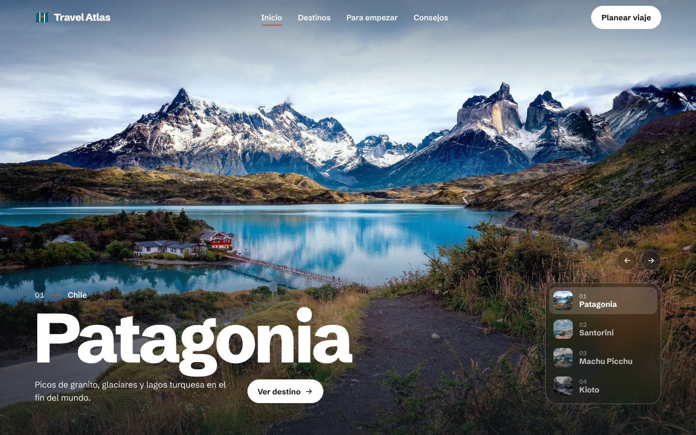
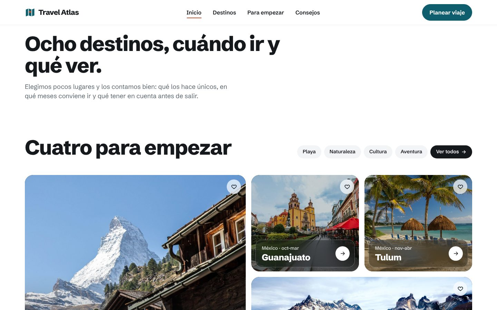
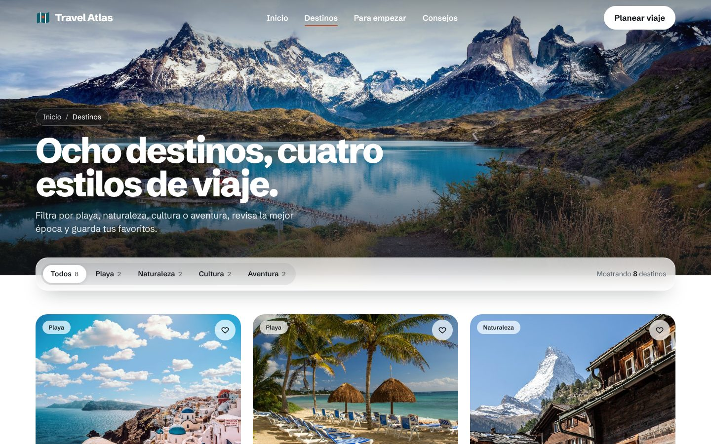
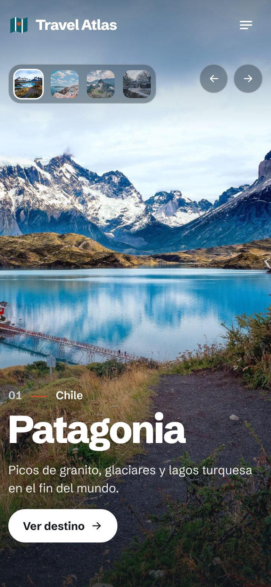
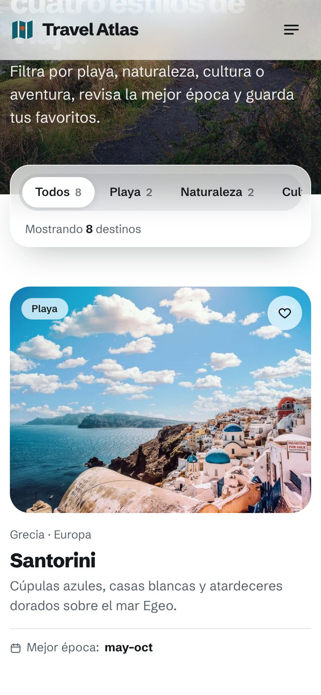
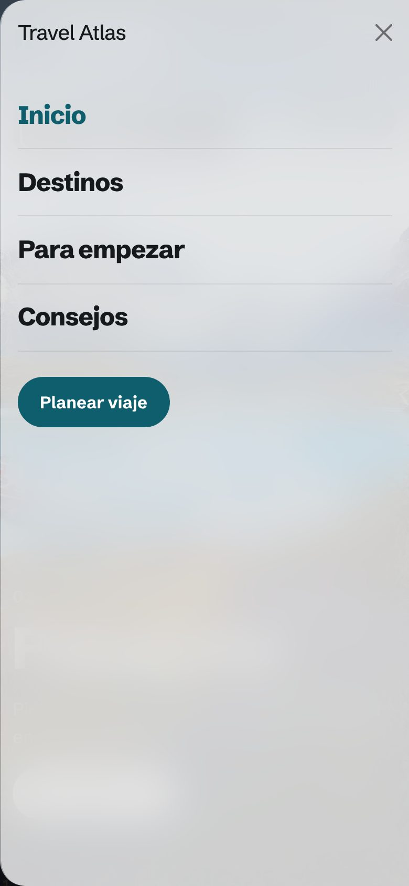

# Travel Atlas

Una pequeña guía de viajes con ocho destinos que me gustan: qué tienen de especial, cuándo conviene ir y algunos consejos para planear el viaje.

Es mi proyecto del Módulo 11 de EBAC, hecho con **Bootstrap 5.3** y un poco de CSS propio para darle personalidad.

## Cómo se ve

### En computadora







### En celular

<p>
  
  
  
</p>

## ¿Qué tiene?

**Inicio (`index.html`)**
- Una portada a pantalla completa con fotos que van cambiando solas.
- Cuatro destinos para empezar, en tarjetas con foto.
- Una invitación final para ver todos los destinos.

**Destinos (`destinos.html`)**
- Los ocho destinos, con su país, su continente y la mejor época para ir.
- Botones para filtrar por playa, naturaleza, cultura o aventura.
- Una sección de preguntas frecuentes con consejos de viaje.

En las dos páginas puedes guardar tus destinos favoritos con el ♡ y suscribirte al boletín. Al hacerlo aparece un aviso en la esquina de la pantalla.

## Lo que pedía la actividad

- **Bootstrap instalado:** se carga desde internet (CDN) en las dos páginas.
- **Grid:** filas y columnas en las tarjetas, las preguntas frecuentes y el pie de página.
- **Se ve bien en cualquier pantalla:** en el celular el menú se vuelve un panel lateral y las tarjetas pasan de tres columnas a una.
- **Componentes vistos en clase:** el carrusel de la portada (**Carousel**) y las preguntas frecuentes (**Accordion**).
- **Dos componentes nuevos:**
  - **Offcanvas**, el menú lateral que se abre en el celular.
  - **Toast**, el aviso que sale al guardar un destino o suscribirte.
- **Personalización:** cambié los colores, la tipografía y las esquinas de Bootstrap para que tuviera mi propio estilo.

## El estilo

- **Colores:** un azul petróleo como color principal y un terracota para los detalles, sacados de las mismas fotos.
- **Tipografía:** *Schibsted Grotesk*, de Google Fonts.
- **Sensación:** limpia y moderna, parecida a las apps del celular. Tiene esquinas redondeadas, botones en forma de cápsula y paneles semitransparentes sobre las fotos.

## Carpetas

```
travel-atlas/
├── index.html
├── destinos.html
├── css/styles.css   → mis estilos
├── js/main.js       → menú, filtros, favoritos y avisos
├── img/destinos/    → fotos grandes, y en sm/ las versiones chicas
└── img/capturas/    → capturas para este README
```

## Cómo verlo

Abre la carpeta en VS Code y usa **Live Server**. Necesitas internet para que carguen Bootstrap y la tipografía.
